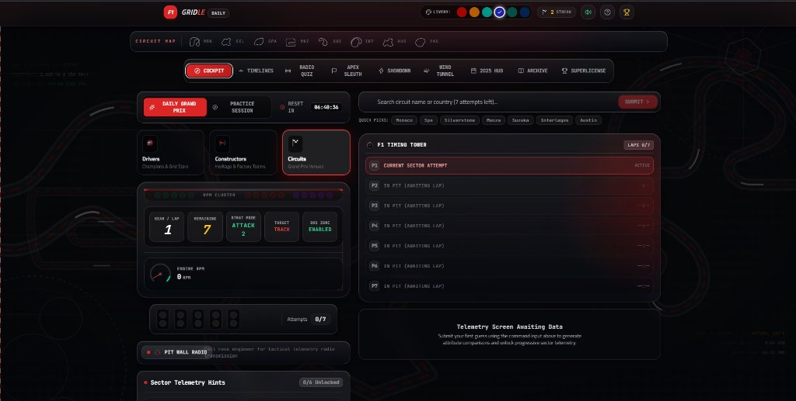
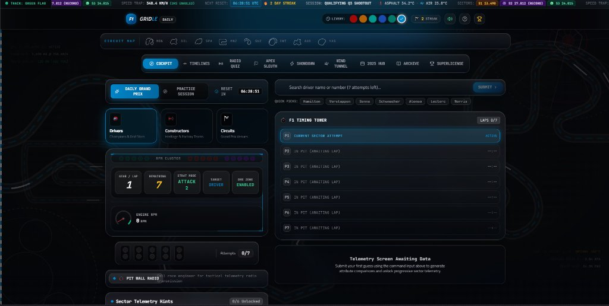

# 🏎️ F1 GRIDLE — Formula 1 Motorsport Mission Control

<div align="center">


**The ultimate single-viewport Formula 1 daily guessing game and telemetry command center.**  
Guess mystery Drivers, Constructors, and Grand Prix Circuits with authentic broadcast telemetry, progressive sector hints, 15-LED shift light clusters, and team livery theme switching.

[Play Live Demo](https://github.com/Anshuljain22/Gridle) • [View Repositories Doc](REPOSITORIES.md) • [Report Issue](https://github.com/Anshuljain22/Gridle/issues)

</div>

---

## 📸 Screenshots & Previews

<div align="center">

### Scuderia Ferrari Livery Theme


### Mercedes AMG / Williams Racing Livery Theme


</div>

---

## ✨ Key Features

### 🖥️ Single-Viewport Zero-Scroll Cockpit HUD
Precision-engineered layout strictly contained in a single 100vh viewport. No vertical scrolling needed during gameplay—all search inputs, telemetry comparison grids, shift lights, and pit wall strategy docks are visible simultaneously.

### 🚦 15-LED Shift Light Bar & RPM Cluster
Authentic Formula 1 steering wheel shift light indicator:
- **5 Green LEDs** → **5 Red LEDs** → **5 Purple LEDs**
- Revs up progressively with every lap attempt
- Flashes green on victory (P1 Pole Position) or displays DNF flags on session retirement

### 🎨 Dynamic Team Livery Theme Engine
Switch between iconic Formula 1 team color schemes in real time:
- 🔴 **Scuderia Ferrari** (Rosso Corsa & Giallo Modena)
- 🟠 **McLaren Formula 1** (Papaya Orange & Anthracite)
- 🟢 **Mercedes-AMG Petronas** (Silver Arrows & Electric Teal)
- 🔵 **Red Bull Racing** (Midnight Racing Navy & Matte Yellow)
- 🌲 **Aston Martin Aramco** (British Racing Green & Lime)
- 🔷 **Williams Racing** (Heritage Royal Blue & Ice Cyan)

*Updates primary highlights, glow filters, search focus rings, button gradients, and the background rotating mechanical gears and CFD airflow streamlines.*

### 📊 3 Grand Prix Categories
1. **Drivers**: Current grid stars, race winners, and World Champions (Hamilton, Verstappen, Senna, Schumacher, Alonso, Norris, Piastri, etc.).
2. **Constructors**: Heritage and active factory teams (Ferrari, McLaren, Mercedes, Red Bull, Williams, Lotus, Brawn GP, etc.).
3. **Circuits**: World-famous Grand Prix venues (Monaco, Spa-Francorchamps, Silverstone, Monza, Suzuka, Interlagos, Austin, etc.).

### ⏱️ Integrated Pit Wall MFD (Multi-Function Display)
- **FIA Timing Tower**: P1 to P7 positions with driver country flags, lap intervals, and delta gaps.
- **Pit-to-Car Radio**: One-click encrypted voice transmission from the race engineer ("Box box", "We see positive delta in sector 2").
- **Progressive Sector Hints**: 6 encrypted telemetry clues that decrypt as you complete hotlaps.

### 🎮 Multiple Game Modes
- **Daily Grand Prix**: Global deterministic challenge reset at midnight UTC.
- **Free Practice Session**: Unlimited replayable rounds with Soft (Easy), Medium, and Hard tire compounds.
- **Career Timelines**: Reconstruct historical driver team transfers chronologically.
- **Team Radio Quiz**: Identify the driver and race from iconic unhinged team radio clips.
- **Apex Sleuth**: Identify the Grand Prix venue from high-speed corner silhouettes.
- **Driver Showdown**: Higher-or-Lower head-to-head career stats battle.
- **Wind Tunnel (Aero Lab)**: Interactive CFD aerodynamic inspector and drag/downforce simulator.
- **2025 Season Hub**: Complete race calendar, circuit layouts, and weather radar.
- **Superlicense & Trophy Room**: Personal career streak tracking, guess distribution charts, and achievement badges.

---

## 🛠️ Tech Stack & Design Systems

F1 GRIDLE is built with modern, high-performance UI libraries:

| Layer | Technology | Description |
| :--- | :--- | :--- |
| **Framework** | [Next.js 14 (App Router)](https://nextjs.org) | Hybrid static site generation & serverless execution |
| **Styling** | [Tailwind CSS](https://tailwindcss.com) | Responsive utility styling & CSS custom variable theming |
| **Motion Physics** | [Motion](https://motion.dev) + [Anime.js](https://animejs.com) | 60 FPS spring physics, staggered telemetry reveals, tachometer sweeps |
| **Text Ciphers** | [React Bits](https://reactbits.dev) | DecryptedText scrambling & ShinyText metallic reflections |
| **Micro-Interactions** | [Motion-Primitives](https://motion-primitives.com) | Aerodynamic glow effects & cursor spotlighting |
| **UI Components** | [Magic UI](https://magicui.design) + [shadcn/ui](https://ui.shadcn.com) | Marquee ticker, retro perspective grid, dialogs, tabs |
| **Tabs & Buttons** | [Watermelon UI / 21st.dev](https://21st.dev) | Spring-animated navigation pills & tactile motion buttons |
| **3D Assets & Avatars** | [3dicons](https://3dicons.co) + [Open Peeps](https://openpeeps.com) | Shaded 3D trophies, helmets, tires, and driver avatars |

For full repository links and component mappings, see [REPOSITORIES.md](REPOSITORIES.md).

---

## 🏎️ How to Play

1. **Pick your Category**: Select **Drivers**, **Constructors**, or **Circuits**.
2. **Submit a Guess**: Type any registered driver, team, or track in the tactical search console.
3. **Analyze Telemetry Feedback**:
   - 🟩 **Green**: Exact match!
   - 🟧 **Amber with Arrow (↑ / ↓)**: Close attribute match with higher/lower directional clue (e.g. Debut year, Age, Wins, Length).
   - ⬛ **Gray / Slate**: No match for this attribute.
4. **Use Sector Hints & Pit Radio**: Unlock tactical clues as you progress through your 7 allowed attempts.
5. **Score Pole Position (P1)**: Identify the mystery target within 7 laps to maintain your daily streak!

---

## 🚀 Local Development Setup

### Prerequisites
- [Node.js](https://nodejs.org/) v18.17 or higher
- [npm](https://www.npmjs.com/) or [pnpm](https://pnpm.io/)

### Installation

1. **Clone the repository**:
   ```bash
   git clone https://github.com/Anshuljain22/Gridle.git
   cd Gridle
   ```

2. **Install dependencies**:
   ```bash
   npm install
   ```

3. **Start the local development server**:
   ```bash
   npm run dev
   ```

4. **Open in browser**:
   Navigate to [http://localhost:3000](http://localhost:3000).

### Production Build
To create an optimized production build:
```bash
npm run build
npm run start
```

---

## ☁️ Deployment (Vercel)

This application is ready for 1-click deployment on [Vercel](https://vercel.com):

1. Push your repository to GitHub.
2. Import the project in Vercel.
3. Framework Preset: **Next.js**.
4. Leave environment variables blank (Supabase is completely optional; all daily challenges and streaks run client-side via deterministic UTC algorithms and `localStorage`).
5. Click **Deploy**.

---

## 📄 License

This project is licensed under the [MIT License](LICENSE).

---

<div align="center">

*F1 GRIDLE is an unofficial motorsport tribute game created for Formula 1 fans worldwide. Data verified through FIA historical records.*

</div>
